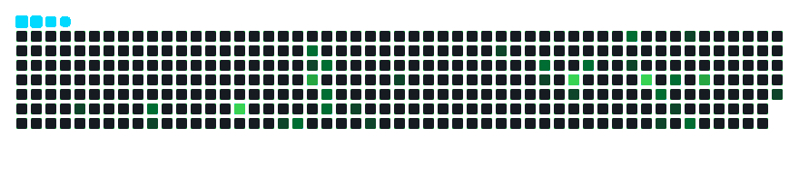

# Hi 👋, I'm Ritesh B M

### AI/ML Engineer · Full-Stack Developer · Generative AI

Computer Science undergraduate at **RNS Institute of Technology**, interested in building AI/ML applications and full-stack systems that solve practical problems.

My work spans **Machine Learning, Deep Learning, Computer Vision, Generative AI, RAG, Multi-Agent Systems, and Full-Stack Development**.

<p align="center">
  <a href="https://github.com/Ritesh-022">
    
  </a>
  <a href="https://www.linkedin.com/in/ritesh-b-m-1b6587340/">
    
  </a>
  <a href="mailto:rithesh22102006@gmail.com">
    
  </a>
</p>

---

## 🧠 About Me

- 🎓 Pursuing B.E. in Computer Science Engineering at **RNS Institute of Technology**
- 🥇 **1st Position — Signal Quest Hackathon**
- 🥉 **3rd Place — IEEE Project Ideathon**
- 🚀 Participated in **10+ hackathons**
- 🤖 Building applications around Machine Learning, Computer Vision and Generative AI
- ⚙️ Developing full-stack applications with the MERN ecosystem
- 🧩 Exploring RAG pipelines, AI agents and multi-agent workflows
- 🔬 Interested in applied AI, intelligent automation and real-world engineering problems

I enjoy working across the stack — from training and evaluating models to building the APIs, data pipelines and interfaces that make them useful.

---

## 🛠️ Technologies & Tools

### Programming Languages

<p>
  
</p>

### Full-Stack Development

<p>
  
</p>

`MERN Stack` · `REST APIs` · `Socket.IO` · `Three.js` · `Vite` · `Tailwind CSS`

### Artificial Intelligence & Machine Learning

**Machine Learning**

- Classical ML · Decision Trees · Random Forest
- Extra Trees · XGBoost · LightGBM
- Anomaly Detection · Model Evaluation

**Deep Learning**

- CNN · MLP · LSTM · GRU
- CNN-LSTM · Autoencoders
- EfficientNet · PyTorch

**Computer Vision**

- YOLOv8 · Object Detection
- Image Classification · Image Segmentation
- Image Processing · EfficientNet

### Generative AI & Agentic Systems

- Large Language Models (LLMs)
- Retrieval-Augmented Generation (RAG)
- LangChain · LangGraph
- Multi-Agent Systems · AI Agents
- Ollama · LLaMA · Qwen
- Local LLM Inference · Tool-based Workflows

### Databases

<p>
  
</p>

### DevOps & Developer Tools

<p>
  
</p>

`Docker Compose` · `GitHub Actions` · `Trivy` · `CodeQL` · `npm Audit` · `Dependabot`

### IoT & Embedded Systems

- ESP32 · Arduino
- HX711 Load Cells
- IoT Sensors · Edge AI

---

## 🏆 Achievements

### 🥇 1st Position — Signal Quest Hackathon

**IEEE Signal Processing Society · CMRIT / IEEE Bangalore Section**

<text>September 2026</text>

### 🥉 3rd Place — IEEE Project Ideathon

**IEEE CAS Society · RNS Institute of Technology**

- Team: **Unknown Error**
- Project: **Smart Campus Saver**

### 🚀 Hackathon Participation

Participated in **10+ hackathons**, collaborating on projects involving AI/ML, full-stack development, IoT and problem-solving.

---

## 🚀 Featured Projects

### 🧠 ResearchAI
**AI Research Assistant**

An AI-powered research platform designed to support academic research, information processing and long-form content generation.

**Highlights**
- Multi-agent LLM pipeline
- RAG-based information retrieval
- Research-oriented AI workflows
- Academic content generation
- Long-form document generation (20,000+ words)
- Local LLM inference using Ollama

**Tech Stack:** React · Node.js · RAG · Multi-Agent AI · Ollama · LLMs

---

### 🛡️ Intelligent Cybersecurity Decision Support System
**AI-Based Network Intrusion Detection & Analysis**

A cybersecurity system combining machine learning and LLM-based analysis to identify network threats and assist with incident investigation.

**Highlights**
- TON_IoT dataset processing and preprocessing
- Binary anomaly detection and multiclass intrusion classification
- Classical ML and deep learning model benchmarking
- Confusion matrices and performance evaluation
- LangGraph-based incident analysis workflow
- Local Qwen inference through Ollama

**Tech Stack:** Python · PyTorch · Machine Learning · LangGraph · Ollama

---

### 🌾 AgroDetect AI
**Plant Disease Detection & Agricultural Intelligence**

An AI-powered agricultural platform for identifying plant diseases and providing relevant treatment guidance.

**Highlights**
- Leaf image analysis and disease classification
- EfficientNet-based classification
- YOLO-based computer vision
- AI-generated treatment recommendations
- Historical analytics
- IoT monitoring support

**Tech Stack:** MongoDB · Express.js · React.js · Node.js · Flask · PyTorch · EfficientNet · YOLOv8 · Ollama

---

### 🍚 RiceAI
**Rice Grain Quality Analysis**

A computer vision-based platform for rice grain analysis, quality assessment and agricultural recommendations.

**Highlights**
- Rice grain detection and segmentation
- YOLO segmentation and EfficientNet-B0 classification
- Rice health scoring and quality grading
- Market-price information
- Shelf-life estimation and storage recommendations
- AI-generated guidance and PDF reports
- Optional IoT integration

**Tech Stack:** YOLO · EfficientNet · Computer Vision · LangChain · Ollama · Full Stack

---

### 🧬 SkinCare AI
**Image-Based Skin Condition Analysis**

An AI-powered platform focused on image classification and skin-condition analysis.

**Highlights**
- EfficientNet-B4-based image classification
- CNN-based image processing
- Multi-image scan sessions
- AI-generated analysis and guidance
- Scan history and patient records

**Tech Stack:** EfficientNet-B4 · CNN · Deep Learning · LLMs · Full Stack

---

### 🛰️ OrbitalX
**Satellite Simulation & Collision Monitoring**

A satellite simulation platform combining 3D visualization, orbital calculations and real-time telemetry.

**Highlights**
- 3D satellite visualization and simulation
- Orbital telemetry processing
- Collision monitoring
- Maneuver scheduling
- Orbital calculations
- Real-time Socket.IO communication
- Multi-service architecture

**Tech Stack:** React · Three.js · Node.js · Express.js · Socket.IO · MongoDB · Python · FastAPI

---

### 💰 BudgetWise
**Personal Finance & Investment Management**

A full-stack financial management platform for tracking expenses, budgets, savings and investments.

**Highlights**
- Expense and transaction management
- Budget tracking and savings goals
- Portfolio and investment tracking
- Financial analytics
- AI-powered financial assistant

**Tech Stack:** Full Stack · Flask · MongoDB · SQLite · AI

---

### 🎓 AI Learning Companion
**Personalized AI Tutoring Platform**

An interactive learning platform designed to support personalized learning through LLM-powered assistance.

**Highlights**
- AI-powered chat tutor
- Local LLM integration
- AI-generated quizzes and feedback
- Learning goals and progress tracking
- Learning analytics
- Multi-subject support

**Tech Stack:** MERN · Ollama · LLMs · AI

---

## 🔬 Areas of Interest

| Domain | Focus Areas |
|:--|:--|
| 🛡️ Cybersecurity | Intrusion Detection, Anomaly Detection, Threat Analysis |
| 🌾 Agriculture | Plant Disease Detection, Rice Analysis, Agricultural AI |
| 🏥 Healthcare | Medical Image Analysis, Classification, Edge AI |
| 🎓 Education | AI Tutoring, Learning Analytics, Risk Prediction |
| 🛰️ Space Technology | Satellite Simulation, Collision Monitoring, Orbital Analysis |
| 💰 FinTech | Personal Finance, Portfolio Management, Investment Analytics |

---

## 🧠 AI & Engineering Focus

```text
Machine Learning
       ↓
Deep Learning
       ↓
Computer Vision
       ↓
Generative AI & LLMs
       ↓
Retrieval-Augmented Generation
       ↓
Multi-Agent Systems
       ↓
Intelligent Full-Stack Applications
```

My focus is on combining models, data processing, backend services and user-facing applications into complete systems.

---

## 📊 GitHub Statistics

<p align="center">
  
  
</p>

<p align="center">
  
</p>

---

## 📈 Contribution Activity

<p align="center">
  
</p>

## 🐍 Contribution Graph

<p align="center">
  
</p>

---

## 📌 Current Focus

```text
Artificial Intelligence
        │
        ├── Machine Learning
        ├── Deep Learning
        ├── Computer Vision
        ├── Generative AI
        ├── RAG & LLM Applications
        └── Multi-Agent Systems
                │
                ▼
       Full-Stack Engineering
                │
                ▼
      Practical Intelligent Systems
```

Currently exploring ways to build better AI applications by combining model capabilities with reliable data pipelines, backend architecture and usable interfaces.

---

## 🌐 Let's Connect

<p align="center">
  <a href="https://github.com/Ritesh-022">
    
  </a>
  <a href="https://www.linkedin.com/in/ritesh-b-m-1b6587340/">
    
  </a>
  <a href="mailto:rithesh22102006@gmail.com">
    
  </a>
</p>

---

<p align="center">
  <i>"Build things. Understand them. Make them better."</i>
</p>

<p align="center">
  Thanks for visiting! ⭐
</p>
